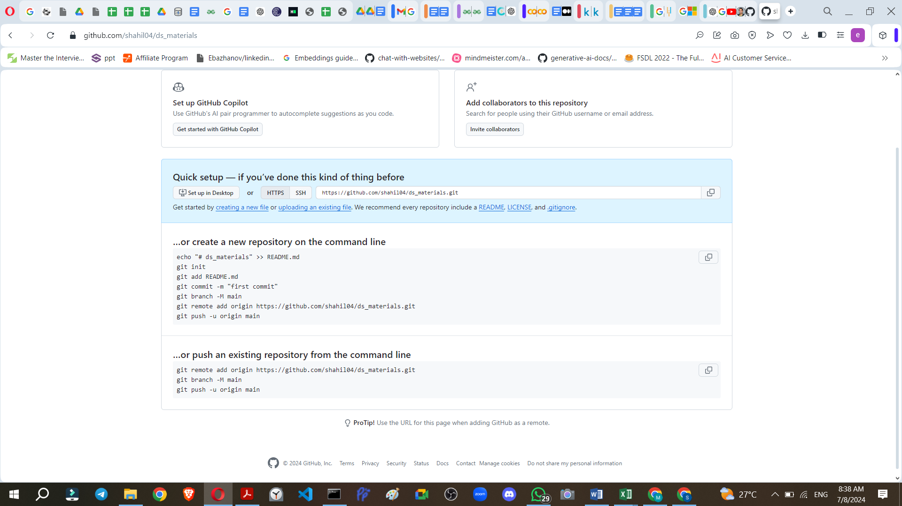

# Git & GitHub Tutorial Notes

This repository collects learning materials and reference notes for practicing Git and GitHub, from initial setup through collaboration and more advanced workflows.

## Suggested Learning Order

1. Start with the account setup and introductory class materials.
2. Read [Git_GitHub_Mastery_Syllabus.md](Git_GitHub_Mastery_Syllabus.md) for the course topics and workflows.
3. Use [git_commands.txt](git_commands.txt) as a practical command reference while working in a local repository.
4. Review the class documents and slide decks for additional explanations and examples.
5. Practice the concepts in a separate test repository before applying unfamiliar commands to important work.

## Materials

- [Git_GitHub_Mastery_Syllabus.md](Git_GitHub_Mastery_Syllabus.md): course outline, workflows, and command cheat sheet.
- [git_commands.txt](git_commands.txt): setup, staging, commits, remotes, and push/pull notes.
- `1.steps for git &github account creation.docx` and `2class git github.docx`: introductory class documents.
- `git errors.docx` and `inclass_.docx`: troubleshooting and in-class notes.
- `git_github.pptx` and `git_githubf.pptx`: presentation materials.
- `extra/`: additional syllabus and from-scratch notes.
- `initial_steps.png`: image accompanying the introductory materials.

## Quick Start

Install Git, configure your identity, and create or clone a repository. A typical local workflow is:

```bash
git status
git add <file>
git commit -m "Describe the change"
git push
```

For a new GitHub repository, add its remote URL and set the upstream branch as prompted by GitHub. Replace example names and URLs with your own; do not copy personal repository URLs from example notes.

## Keep Credentials Private

Never commit passwords, access tokens, private keys, or other secrets. Use `.gitignore` for local files that should not be tracked, and check `git status` before committing.